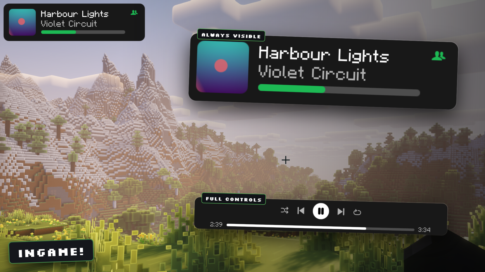
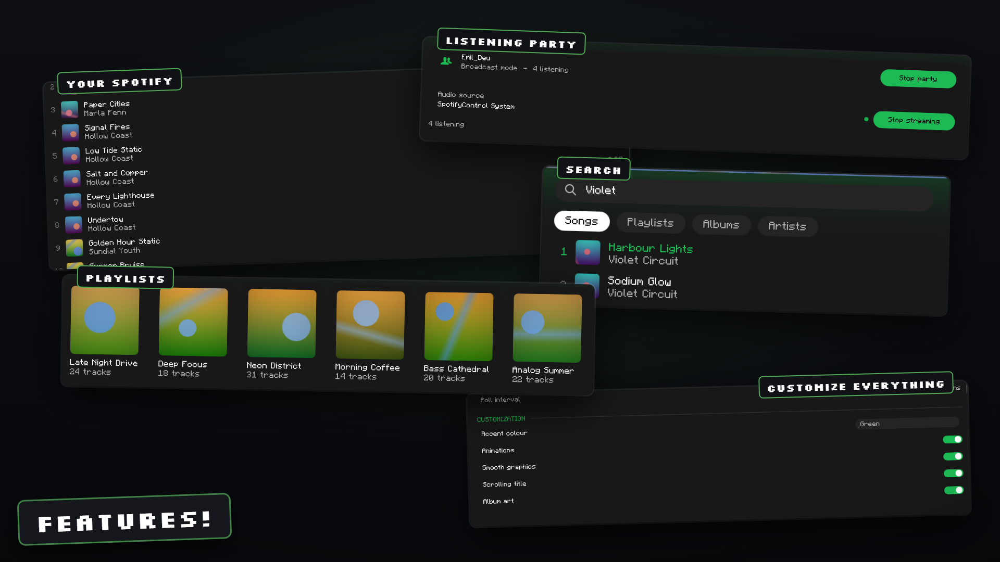
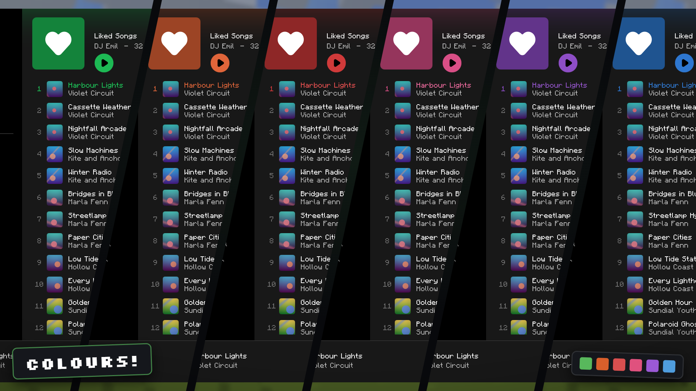

<!-- MODRINTH SUMMARY (paste into Project Settings → Summary, max 256 chars) -->
<!-- Spotify overlay for Minecraft: search, browse and manage your library, control playback, and host listening parties where the whole server hears the same music through Simple Voice Chat. -->

<p align="center">
  
</p>

A Fabric mod that puts a Spotify client into Minecraft. Press Ctrl + M to open a full overlay in the
Spotify colour theme, log in with your own Spotify account, browse your library, search, manage
playlists and control playback without leaving the game. A listening party feature lets other players
on the server hear the same music, either through their own Spotify account or as a live audio stream
over Simple Voice Chat.

The mod talks to the official Spotify Web API. It does not decode, download or re-host Spotify audio
in sync mode, and broadcast mode captures whatever your operating system is already playing: on
Windows straight from the speakers with nothing to install, on other systems from a loopback device
you select yourself.

<p align="center">
  
</p>

<p align="center"><sub>Now playing HUD in any corner, and the full player bar without leaving the world</sub></p>

### Features

- Full-screen overlay in the Spotify colour theme (#121212 base, #1DB954 accent) with sidebar, search,
  library, playlist detail view and a bottom player bar
- OAuth 2.0 login with PKCE, no client secret needed, tokens stored locally and refreshed automatically
- Playback control: play, pause, next, previous, seek, volume, shuffle, repeat, queue and device transfer
- Starts the Spotify desktop app minimized in the background when no device is running, so you never have to open it yourself
- Library: your playlists, Liked Songs, recently played, top tracks, and per-playlist track lists
- Queue view with the current track on top, refreshed every 5 seconds, click any entry to jump to it
- Search across tracks, playlists, albums and artists with tabs for each result type
- Playlist management: create playlists, add and remove tracks, like and unlike tracks
- Album art rendered in game with rounded corners, downloaded on demand and cached as GPU textures
- Vector icons and panel corners rasterized at native screen resolution with anti-aliasing, so nothing looks blocky at any GUI scale
- Now-playing HUD in any screen corner with track, artist and a progress bar
- Listening parties in two modes: SYNC keeps every member's own Spotify player on the same track and
  position, BROADCAST streams the host's desktop audio to the party through Simple Voice Chat
- Locational broadcast option so everyone within a configurable block radius hears the host, or static
  channels so only party members hear it anywhere in the world
- On Windows, BROADCAST captures the speakers through the sound system itself, so there is no Stereo
  Mix to enable and no virtual cable to install
- Overlay renders at its own GUI scale (2 by default) so it stays compact when the game runs at scale 3 or 4
- Mod Menu integration: the Configure button opens the overlay settings, also from the title screen
- Seven languages: English, German, Russian, Spanish, French, Japanese, Chinese

<p align="center">
  
</p>

<p align="center"><sub>Library, search, listening parties and the settings, all inside the game</sub></p>

### Setup

The mod needs a Spotify application of your own, because Spotify does not allow shipping a client ID
inside a public mod.

1. Open developer.spotify.com/dashboard and create an app.
2. Add `http://127.0.0.1:8888/callback` as a redirect URI. If you change `callbackPort` in the config,
   use that port instead.
3. Copy the client ID from the app page.
4. In Minecraft, press Ctrl + M, open Settings in the sidebar and paste the client ID.
5. Click Connect to Spotify. A browser tab opens, you approve the scopes, and the tab closes itself.

Playback control requires Spotify Premium. With a free account the overlay still shows your library,
search results and what is currently playing, but play, pause, seek and volume calls are rejected by
the Spotify API with HTTP 403.

Spotify also needs a playback device, because the Web API controls a Spotify player rather than being
one. You do not have to manage that yourself: when you press play and nothing is running, the mod
starts the Spotify desktop app minimized in the background, waits for it to show up as a device and
moves playback there. Any other device (web player, phone, speaker) works too and can be picked from
the device menu in the player bar.

### Listening parties

SYNC mode is the default. The host reports the current track URI and position to the server, the
server forwards it to every party member, and each member's client calls the Spotify API to play the
same track at the same position on their own account. Everyone needs their own Premium account. Audio
quality is whatever Spotify normally delivers, and no audio travels through the Minecraft server.

BROADCAST mode is for parties where the other players do not have Spotify. The client reads 20 ms
frames of 48 kHz stereo audio from the host's audio source, downmixes to mono, encodes them with the
Opus encoder provided by Simple Voice Chat, and sends them to the server. The server pushes the
frames into a Simple Voice Chat audio channel.

On Windows there is nothing to install and nothing to enable. The mod asks the sound system for the
mix that is going to the speakers and captures it there, so the audio source starts on "System sound
(automatic)" and a machine that has never been set up for this simply works. The price is that this
is the whole mix: Minecraft's own sound, notification sounds and voice chat from other applications
go out with the music. Mute what you do not want to send before starting the stream.

For Spotify and nothing else, the manual device choice is still there. Install a virtual audio cable
such as VB-Audio Virtual Cable, set Spotify alone to output to it in the Windows app volume settings
and select its input in the mod; only Spotify goes through the cable, so nothing else can leak into
the party. Stereo Mix, enabled in the Sound Control Panel, is the other manual option, but it carries
the whole desktop just as the automatic capture does.

On Linux and macOS the automatic capture does not apply and broadcast mode still needs a loopback
device, an input line that carries what the machine is playing back rather than what a microphone
hears. On Linux the "Monitor of" source of PipeWire or PulseAudio works as it is, on macOS a loopback
driver such as BlackHole does. A microphone is not a substitute: pick one and the party hears your
room instead of the music, and muting yourself in the voice chat does not help, because the capture
is a second line straight from the sound system. The mod lists the loopback devices first and marks
which entries look like an output and which look like a microphone, and it warns while streaming
from a microphone rather than claiming to send desktop audio.

### Configuration

Server side, `config/spotifycontrol/server.json`:

```json
{
  "enabled": true,
  "language": "en",
  "allowListeningParties": true,
  "allowAudioBroadcast": true,
  "maxPartySize": 20,
  "broadcastRangeBlocks": 0,
  "requireSameDimension": true,
  "maxAudioKilobitsPerSecond": 96,
  "announcePartyInChat": true,
  "broadcastNowPlayingToParty": true,
  "partyIdleTimeoutSeconds": 120
}
```

| Key | Meaning |
|---|---|
| `enabled` | Master switch, same as `/spotifycontrol off` |
| `language` | Language file used for server chat messages |
| `allowListeningParties` | Allow players to open listening parties at all |
| `allowAudioBroadcast` | Allow BROADCAST mode, ignored when Simple Voice Chat is missing |
| `maxPartySize` | Host plus members |
| `broadcastRangeBlocks` | 0 sends audio only to party members through static channels, any value above 0 opens a locational channel at the host with that radius so nearby players hear it too |
| `requireSameDimension` | Skip party members who are in another dimension (static channels only) |
| `maxAudioKilobitsPerSecond` | Reported to clients as the broadcast budget |
| `announcePartyInChat` | Send join and leave lines to the party |
| `broadcastNowPlayingToParty` | Forward track metadata, required for SYNC mode |
| `partyIdleTimeoutSeconds` | Close a broadcast party after this long without audio, 0 disables |

Client side, `config/spotifycontrol/client.json`:

```json
{
  "language": "en",
  "spotifyClientId": "",
  "callbackPort": 8888,
  "requireModifierKey": true,
  "modifierKey": "CONTROL",
  "playbackPollMillis": 2000,
  "showNowPlayingHud": true,
  "hudCorner": "TOP_RIGHT",
  "hudGuiScale": 2,
  "appMargin": 10,
  "startView": "HOME",
  "smoothGraphics": true,
  "hudMargin": 4,
  "overlayGuiScale": 2,
  "pauseGameOnOverlay": false,
  "blurBackground": true,
  "overlayVolumeStep": 5,
  "autoLaunchSpotify": true,
  "minimizeSpotifyWindow": true,
  "preferredDeviceName": "",
  "captureDeviceName": "",
  "captureVolumePercent": 100,
  "muteMinecraftMusicWhileListening": true,
  "showAlbumArt": true,
  "albumArtCacheSize": 128,
  "backgroundDim": 50,
  "accentColor": 0,
  "overlayKeyCode": -1,
  "scrollingTitles": true,
  "dimUnavailableTracks": true,
  "showTrackTime": true,
  "showShuffleRepeat": true,
  "showVolumeSlider": true,
  "showQueueButton": true,
  "showDeviceButton": true,
  "showLikeButton": true,
  "hudShowAlbumArt": true,
  "hudShowProgress": true,
  "hudShowArtist": true,
  "hudOnlyWhilePlaying": false,
  "pauseOnLeave": true,
  "closeSpotifyOnQuit": true
}
```

| Key | Meaning |
|---|---|
| `spotifyClientId` | Client ID of your own Spotify app |
| `callbackPort` | Port of the local OAuth callback server, must match the redirect URI |
| `requireModifierKey` / `modifierKey` | Modifier that has to be held with the key bindings, one of CONTROL, SHIFT, ALT, NONE |
| `playbackPollMillis` | How often the client asks Spotify for the playback state while the app or overlay is on screen, between 1000 and 5000. Polling slows to 8 s while paused and to 30 s while nothing of the mod is visible, to stay well inside Spotify's rate limit |
| `hudCorner` | TOP_LEFT, TOP_RIGHT, BOTTOM_LEFT or BOTTOM_RIGHT |
| `hudMargin` | Distance of the small overlay from its corner, both axes |
| `appMargin` | Distance between the screen edge and the app window, both axes |
| `startView` | Page the app opens on: HOME, SEARCH, LIBRARY or LIKED |
| `smoothGraphics` | Off draws the same vector shapes at a coarse resolution with hard edges, two screen pixels per block |
| `overlayGuiScale` | GUI scale the overlay renders at, independent of the game setting: 2 keeps it compact on 1080p and 1440p, 0 follows the game scale, never larger than the game scale |
| `pauseGameOnOverlay` | Pause singleplayer while the overlay is open |
| `autoLaunchSpotify` | Start the Spotify desktop app when you press play and no device is running, then move playback to it |
| `minimizeSpotifyWindow` | Start it minimized so it does not cover the game |
| `preferredDeviceName` | Device to prefer when several are available, empty picks the active one, then any computer |
| `captureDeviceName` | Audio source for BROADCAST mode, picked in the overlay settings, empty for the automatic speaker capture on Windows |
| `captureVolumePercent` | Gain applied before Opus encoding, 0 to 200 |
| `muteMinecraftMusicWhileListening` | Stop the vanilla music manager while Spotify is playing |
| `albumArtCacheSize` | Number of album covers kept as GPU textures |
| `backgroundDim` | How strongly the game behind the overlay is darkened, 0 to 100 |
| `accentColor` | Accent palette: 0 green, 1 blue, 2 purple, 3 orange, 4 pink, 5 red |
| `hudGuiScale` | Gui scale the HUD renders at, same steps as `overlayGuiScale` |
| `overlayKeyCode` | GLFW code of the key that opens the overlay, -1 keeps the game's key binding |
| `scrollingTitles` | Slide titles that do not fit back and forth instead of cutting them off |
| `dimUnavailableTracks` | Grey out and block tracks Spotify reports as unplayable in your country |
| `showTrackTime`, `showShuffleRepeat`, `showVolumeSlider`, `showQueueButton`, `showDeviceButton`, `showLikeButton` | Individual parts of the player bar, all switchable in the overlay settings |
| `hudShowAlbumArt`, `hudShowProgress`, `hudShowArtist`, `hudOnlyWhilePlaying` | Parts and behaviour of the small now playing overlay |
| `pauseOnLeave` | Pause Spotify when leaving a world or server |
| `closeSpotifyOnQuit` | Close the Spotify desktop app when Minecraft closes |

Tokens live in `config/spotifycontrol/tokens.json`. Delete the file or use Log out in the overlay
settings to disconnect the account.

<p align="center">
  
</p>

<p align="center"><sub>Six accent palettes, switched in the settings without a restart</sub></p>

### Key bindings

All bindings are rebindable in the vanilla Controls screen under the SpotifyControl category. With
`requireModifierKey` on, the configured modifier has to be held as well.

| Binding | Default | Action |
|---|---|---|
| Open Spotify overlay | Ctrl + M | Open the overlay |
| Play / Pause | Ctrl + K | Toggle playback |
| Next track | Ctrl + . | Skip forward |
| Previous track | Ctrl + , | Skip back |
| Volume up | Ctrl + Page Up | Raise volume by `overlayVolumeStep` |
| Volume down | Ctrl + Page Down | Lower volume by `overlayVolumeStep` |
| Toggle now-playing HUD | Ctrl + H | Show or hide the HUD |

### Permissions

| Permission | Description | Default |
|---|---|---|
| Permission level 2 (OP) | `/spotifycontrol on`, `off`, `reload` | OP |
| Permission level 0 | `/spotifycontrol status` and all `party` subcommands | Everyone |

Permissions use the vanilla permission levels 0 to 4. For per-node control, use the Fabric Permissions
API or LuckPerms Fabric.

### Commands

| Command | Description |
|---|---|
| `/spotifycontrol on` | Enable the mod globally |
| `/spotifycontrol off` | Disable the mod globally and close all parties |
| `/spotifycontrol status` | Show current state, party count, listener count and voice chat status |
| `/spotifycontrol reload` | Reload the server config and push it to all clients |
| `/spotifycontrol party start [sync\|broadcast]` | Open a listening party, SYNC when no mode is given |
| `/spotifycontrol party stop` | Close your listening party |
| `/spotifycontrol party join <host>` | Join another player's listening party |
| `/spotifycontrol party leave` | Leave the party you are in |
| `/spotifycontrol party invite <player>` | Send an invite line to a player |

Alias: `/sc`, full command: `/spotifycontrol`

### Supported versions

One jar covers 1.21 through 1.21.11. Minecraft broke the client API six times during that line, so
the mod carries one implementation per generation and picks the right one when it starts.

| Minecraft | Implementation | What changed in that generation |
|---|---|---|
| 1.21, 1.21.1 | `platform.impl.a` | Baseline |
| 1.21.2 to 1.21.4 | `platform.impl.b` | `GuiGraphics.blit` takes a `RenderType` factory |
| 1.21.5 | `platform.impl.c` | `DynamicTexture` needs a label supplier |
| 1.21.6 to 1.21.8 | `platform.impl.d` | Render pipelines, `Matrix3x2fStack` replaces `PoseStack` |
| 1.21.9, 1.21.10 | `platform.impl.e` | Input events became records, key bindings need a `KeyMapping.Category` |
| 1.21.11 | `platform.impl.f` | `ResourceLocation` renamed to `Identifier`, `Util` moved, permission sets |

Each implementation is two classes. Everything else, roughly 60 classes, is shared and compiles to
byte-identical code on every generation. The release is a single file, `SpotifyControl_1.0_1.21.x_BETA.jar`.

### Requirements

| | |
|---|---|
| Minecraft | 1.21 to 1.21.11, one universal jar |
| Fabric Loader | 0.16+ |
| Fabric API | Latest for your Minecraft version |
| Java | 21+ |
| Simple Voice Chat | 2.5+, optional, only for BROADCAST mode |
| Mod Menu | Optional, adds a Configure button |
| Spotify | Premium for playback control, any account for browsing |

Drop `SpotifyControl_1.0_1.21.x_BETA.jar` into `mods/` together with Fabric API. It covers every
Minecraft version from 1.21 to 1.21.11. For listening parties the mod has to be on the server as
well, and BROADCAST mode needs Simple Voice Chat on both sides. Forge, NeoForge and Quilt are not
supported.

### How it works

Authentication uses the OAuth 2.0 authorization code flow with PKCE. The client generates a verifier,
opens the Spotify consent page through `Util.getPlatform().openUri`, and runs a
`com.sun.net.httpserver.HttpServer` bound to 127.0.0.1 for the single callback request. Access tokens
are refreshed on demand inside `SpotifyApi.raw`, which also retries once on HTTP 401 and honours the
`Retry-After` header on HTTP 429. All API traffic runs on one daemon thread so the render thread never
blocks on a network call.

Rendering avoids texture atlases and ships no icon PNGs. Every icon is a signed distance field
composed in `IconShapes` from circles, capsules, boxes, arcs and triangles. `RasterCache` evaluates
the field at the exact pixel size the icon will occupy on screen (GUI size times GUI scale), turns the
distance into anti-aliased coverage, encodes the result as an in-memory PNG and hands it to
`NativeImage.read`, which is the one image entry point that stayed stable across the whole 1.21 line.
The texture is then drawn at a one-to-one pixel mapping, so there is no resampling and no blur.
Rounded panels use the same trick for their four corners and straight fills for the rest, and album
art gets its rounded corners from inverted corner masks drawn on top. Album art itself is decoded
with `NativeImage.read` and registered as a `DynamicTexture`. Minecraft changed that part of the client API six times during the 1.21 line, so
every call that moved sits behind the `PlatformApi` interface. Six implementations live in
`src/platform-a` through `src/platform-f`, each compiled against its own Minecraft version, and the
universal jar bundles all six under `xx.xxxx.spotifycontrol.platform.impl`. On first use `Platform`
reads the Minecraft version from Fabric Loader and loads the matching implementation by name. The
other five are never class-loaded, so their incompatible bytecode is never verified.

That split only works because the remaining code is genuinely version-independent. Of the 69 distinct
Minecraft methods the shared classes call, 66 keep the same intermediary name and descriptor across
all twelve releases. The three that do not, `GuiGraphics.drawString` (return type changed),
`ServerPlayer.sendSystemMessage` (renamed) and `ServerPlayer.level` (return type changed), go through
the platform layer as well. With those wrapped, the shared classes compile to byte-identical output on
every generation, which the build verifies by diffing the remapped jars.

Party state travels over three custom payloads registered with `PayloadTypeRegistry`. The host's
client sends `now_playing` whenever the track changes or every five seconds, the server fans it out to
party members, and members in SYNC mode call the Spotify API to match track and position when the
drift exceeds 2.5 seconds. In BROADCAST mode the client encodes 960-sample Opus frames with the
encoder from the Simple Voice Chat client API and sends them as `audio_frame` packets. The server
relays each frame straight into a `StaticAudioChannel` per listener, or into one
`LocationalAudioChannel` at the host position when `broadcastRangeBlocks` is above 0. Simple Voice
Chat classes are only touched behind a `FabricLoader.isModLoaded("voicechat")` check, so the mod runs
normally without it.

Spotify is a trademark of Spotify AB, which is not affiliated with this project.
